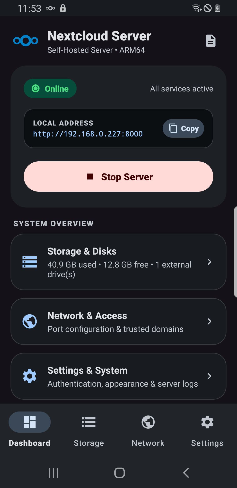
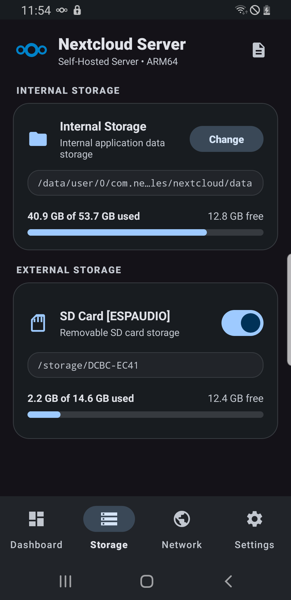
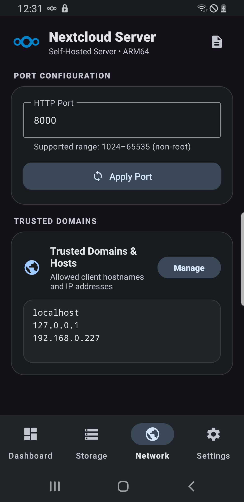
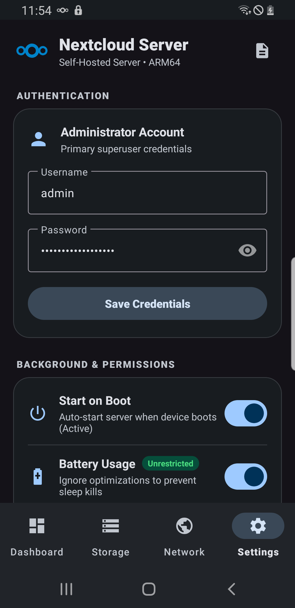

# Nextcloud Server for Android

A self-hosted Nextcloud server running natively on ARM64 Android devices without requiring root access.

---

## About

Nextcloud Server for Android packages a complete, native Linux server stack into an Android application. It allows any Android device running Android 8.0 or newer to function as a standalone, pocket-sized private cloud. All server components—Nginx, PHP-FPM, SQLite, and Nextcloud Core—run directly on-device with support for internal storage and external media (MicroSD cards and USB OTG drives).

---

## Releases & Downloads

Pre-built packages are available on [GitHub Releases](https://github.com/roufsweb/nextcloud-server-android/releases) and on the [Web Landing Page](https://roufsweb.github.io/nextcloud-server-android/):

* **Standalone APK (Direct Install — No Unzipping Required)**:
  * **File**: [`nextcloud-server-v1.0.0-arm64-v8a.apk`](https://github.com/roufsweb/nextcloud-server-android/releases/download/v1.0.0/nextcloud-server-v1.0.0-arm64-v8a.apk) (**391.9 MB**)
  * **SHA-256**: `EF0B1FB2E34FDF80C90979A9DED9A96D459C651F275A8470A2731BF8E98642F4`
  * **Installation**: Download the `.apk` directly to your Android device, tap to install, and grant storage permissions when prompted.
* **Target Architecture**: ARM64 (`arm64-v8a` / aarch64)
* **Supported OS**: Android 8.0 (API 26) through Android 17 (16 KB page-size kernel & SELinux W^X compliant)

---

## Default Administrator Credentials

Upon first installation, the server automatically pre-configures a default administrator account:

* **Username**: `admin`
* **Password**: `NextcloudAdmin123!`

> [!TIP]
> You can customize your administrator username and password at any time in the app under the **Settings & System** tab. Nextcloud requires passwords to be at least 8 characters long.

---

## Interface

| Dashboard | Storage Management |
| :---: | :---: |
|  |  |

| Network & Access | Settings & System |
| :---: | :---: |
|  |  |

---

## Key Features

* **Complete Native Server Stack**: Runs Nginx reverse proxy, PHP-FPM, and SQLite compiled for ARM64 (`arm64-v8a`).
* **Hot-Plug External Storage**: Automatically detects and mounts MicroSD cards, USB OTG flash drives, and external SSDs. Each drive gets an independent toggle switch and capacity meter.
* **Full Nextcloud Feature Support**: Full WebDAV compliance, nested folder structures, move/copy/delete operations, and fast chunked file uploads (tested with 100MB+ payloads at 11+ MB/s).
* **Mobile Auto-Backup**: Seamlessly accepts photo and video camera uploads from official Nextcloud Android and iOS clients.
* **Network & Domain Controls**: Configurable HTTP ports (1024–65535) and dynamic trusted domains management for local LAN or remote access.
* **Remote Access Ready**: Works out-of-the-box through local Wi-Fi, reverse proxies, and Cloudflare Tunnels (`cloudflared`).
* **Background Reliability**: Runs as an Android Foreground Service with partial wake lock protection and optional auto-start on device boot.
* **Material Design 3 UI**: Clean, responsive interface following Android Material 3 guidelines with full system dark theme support.

---

## Requirements

* **Operating System**: Android 8.0 (Oreo, API 26) through Android 17 (API 36+). Tested and verified on Android 8, 9, 10, 11, 12, 13, 14, 15, 16, and 17.
* **Architecture**: 64-bit ARM (`arm64-v8a`).
* **Kernel Page Alignment**: 100% compatible with both 4 KB and modern 16 KB page-size kernels.
* **Memory**: Minimum 2 GB RAM (3 GB or more recommended).
* **Storage**: At least 500 MB free internal storage for server binaries and Nextcloud core files.

---

## Architecture Overview

```
+-----------------------------------------------------------+
|                      Client Devices                       |
|   (Web Browser, Nextcloud Mobile Apps, Desktop Sync)      |
+-----------------------------------------------------------+
                              |
                     HTTP / WebDAV Requests
                              |
+-----------------------------v-----------------------------+
|               Nextcloud Server Android App                |
|                                                           |
|   +---------------------------------------------------+   |
|   |         Android App Layer (Kotlin, Jetpack)       |   |
|   |  - Foreground Service & Wakelock Management       |   |
|   |  - Storage Hot-Plug Detection (BroadcastReceiver) |   |
|   |  - Material Design 3 Settings & Dashboard UI      |   |
|   +---------------------------------------------------+   |
|                             |                             |
|   +-------------------------v-------------------------+   |
|   |                 Embedded Server Stack             |   |
|   |  - Nginx (Reverse proxy & static file server)     |   |
|   |  - PHP-FPM (FastCGI execution engine)             |   |
|   |  - SQLite (Embedded relational database)          |   |
|   |  - Nextcloud Core (v35.x)                         |   |
|   +---------------------------------------------------+   |
+-----------------------------------------------------------+
                              |
                Direct POSIX High-Speed Storage
                              |
          +-------------------+-------------------+
          |                                       |
+---------v---------+                   +---------v---------+
|  Internal Storage |                   |  External Storage |
|  (/data/user/0/)  |                   |  (MicroSD / USB)  |
+-------------------+                   +-------------------+
```

---

## Building from Source

### Prerequisites
* Android Studio Iguana / Jellyfish or Android SDK command-line tools.
* Java Development Kit (JDK) 17.
* Android NDK (r25c or newer for ARM64 native binaries).

### Build Commands

```bash
# Clone the repository
git clone https://github.com/your-username/nextcloud-server-android.git
cd nextcloud-server-android

# Build Debug APK
./gradlew assembleDebug

# Build Release APK
./gradlew assembleRelease
```

The resulting APK will be generated at:
```
app/build/outputs/apk/debug/app-debug.apk
```

---

## Credits & Acknowledgements

This project builds upon the work of several open-source communities:

* **[Nextcloud](https://nextcloud.com)**: For the private cloud software and core web platform.
* **[Nginx](https://nginx.org)**: For the high-performance HTTP server and reverse proxy.
* **[The PHP Group](https://www.php.net)**: For the PHP runtime and FastCGI Process Manager (PHP-FPM).
* **[SQLite](https://www.sqlite.org)**: For the lightweight, embedded SQL database engine.
* **[Termux Project](https://termux.dev)**: For toolchain patterns and cross-compiled Linux packages targeting Android Bionic.
* **[Google Material Design](https://m3.material.io)**: For the Material 3 design system and components.
* **[Cloudflare](https://www.cloudflare.com)**: For Cloudflare Tunnel technology enabling secure external access without port forwarding.

---

## License

This project is licensed under the GNU General Public License v3.0 (GPL-3.0) to remain compatible with Nextcloud's licensing standards.
